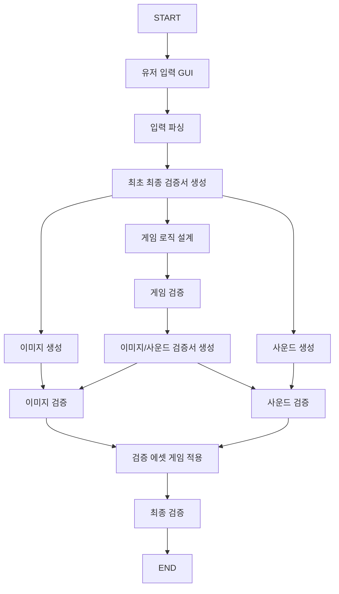

# MainFlowChart

사용자의 이미지 스타일, 게임 장르, 품질 입력을 바탕으로 이미지·게임 로직·사운드 생성을 병렬 처리하고 검증과 에셋 적용으로 연결하는 LangGraph 기반 게임 제작 파이프라인이다.

현재 production Node에는 실제 AI API와 Unity 연동 대신 placeholder가 포함되어 있다. 파일 교환과 병렬 실행은 `tests/`의 mock Agent로 검증한다.

## 저장소 구조

```text
MainFlowChart/
├─ mainflow/                       # 실행 코드와 공통 데이터 계약
│  ├─ ArtifactManager.py           # 파일 저장·조회·무결성 검증
│  ├─ contracts.py                 # Agent 입출력 타입의 단일 기준
│  ├─ langgraph_game_flow_skeleton.py
│  ├─ run_flow.py                  # headless CLI
│  └─ nodes/                       # Node별 독립 구현
│     ├─ user_input.py
│     ├─ parse_input.py
│     ├─ generate_image.py
│     ├─ design_game_logic.py
│     ├─ generate_sound.py
│     └─ ...                       # 검증·통합 Node 포함
├─ docs/                           # 팀 규약과 운영 문서
│  ├─ assets/langgraph_flow.png
│  ├─ ContractRule.md
│  ├─ DockerManager.md
│  └─ FileSystem.md
├─ examples/                       # 실행 요청 예제
│  └─ request.example.json
├─ tests/                          # mock Agent, fixture, 단위·통합 테스트
├─ workspace/                      # 실행 산출물(Git 제외)
├─ Dockerfile
├─ compose.yaml
├─ pyproject.toml
└─ uv.lock
```

## 실행

Docker로 기본 Flow를 실행한다.

```powershell
docker compose build
docker compose run --rm mainflow
```

로컬에서는 Python 3.11과 uv를 사용한다.

```powershell
uv sync --locked
uv run --locked python -m mainflow.run_flow `
  --image-style "Pixel Art" `
  --genre Action `
  --quality Medium
```

JSON 요청 파일을 사용할 수도 있다.

```powershell
uv run --locked python -m mainflow.run_flow `
  --request-file examples/request.example.json
```

## 테스트

```powershell
uv run --locked python -m unittest discover -s tests -v
docker compose --profile test run --rm test
```

## 코드 포맷

저장소 전체의 Python과 C# 코드는 동일한 스크립트로 포맷한다. Python은 Ruff,
C#은 CSharpier를 사용하며, 해당 언어 파일이 없는 저장소에서는 자동으로 건너뛴다.

```powershell
python -m pip install -r tools/format-requirements.txt
python tools/format_repo.py --write
python tools/format_repo.py --check
```

`.editorconfig`를 지원하는 IDE는 기본 들여쓰기와 줄바꿈 규칙을 자동으로 읽는다.
PR에서는 `Repository Format Check` 워크플로가 같은 규칙을 다시 검사한다.

## 팀 규약

- 데이터 계약: [ContractRule.md](docs/ContractRule.md)
- 파일 교환 규약: [FileSystem.md](docs/FileSystem.md)
- Docker 및 실행 환경: [DockerManager.md](docs/DockerManager.md)
- 테스트 결과: [TestResult.md](tests/TestResult.md)
- Graph 이미지: [langgraph_flow.png](docs/assets/langgraph_flow.png)

## Workflow



State에는 실제 파일이나 절대 경로를 넣지 않고 `ArtifactReference`만 전달한다. 실제 파일은 `ArtifactManager`를 통해 `workspace/{project_id}`에 저장하고 읽는다.

각 Node는 `mainflow/nodes/`의 독립 모듈에 둔다. Node 함수 바로 위에는 이전·다음 Node, 입력·출력 State, 입력·출력 파일을 기록한다. Node끼리 직접 호출하지 않으며 Graph State와 `ArtifactReference`로만 통신한다.
