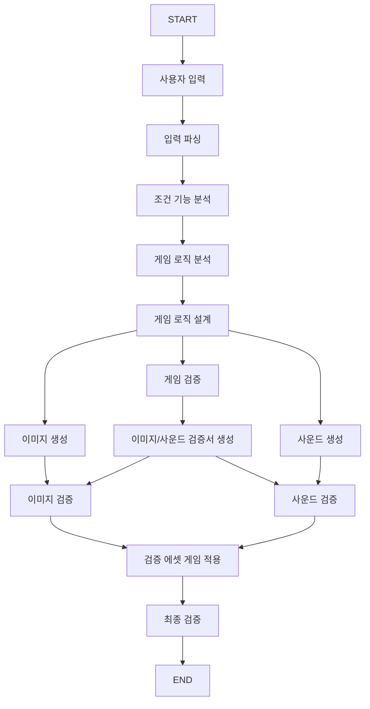

# MainFlowChart

사용자의 이미지 스타일, 분위기 스타일, 게임 장르, 시점, 한 문장 조건을 분석한 뒤 게임을 먼저
설계한다. 설계에서 만든 이미지·사운드 요청 JSON을 각 생성 Agent에 전달하고 결과를
검증·통합하는 LangGraph 기반 게임 제작 파이프라인이다.
게임 로직 Node는 장르별 모듈을 조합하고 prefab·씬 placeholder를 배치한 Unity 프로젝트와 ZIP을 생성한다. 이미지·사운드 생성
Node에는 실제 AI API 연동 전 단계의 placeholder가 포함돼 있다.

## 구조

```text
MainFlowChart/
├─ mainflow/
│  ├─ ArtifactManager.py
│  ├─ contracts.py
│  ├─ langgraph_game_flow_skeleton.py
│  ├─ run_flow.py
│  └─ nodes/
│     ├─ user_input.py
│     ├─ parse_input.py
│     ├─ analysis.py
│     ├─ logic_analysis.py
│     ├─ generate_image.py
│     ├─ design_game_logic.py
│     ├─ generate_sound.py
│     └─ ...                       # 검증·통합 Node 포함
├─ MCP/                            # MCP 서버, 클라이언트, Node 도구 정책
├─ CI/CD/LocalWeb/                  # 로컬 웹 UI
├─ docs/                           # 팀 규약과 운영 문서
│  ├─ assets/langgraph_flow.png
│  ├─ ContractRule.md
│  ├─ DockerManager.md
│  ├─ FileSystem.md
│  └─ MCPManager.md
├─ examples/                       # 실행 요청 예제
│  └─ request.example.json
├─ unity_template/                 # 생성기가 복사할 Unity 6 2D 기본 프로젝트
├─ tests/                          # mock Agent, fixture, 단위·통합 테스트
├─ workspace/                      # 실행 산출물(Git 제외)
├─ Dockerfile
├─ compose.yaml
├─ pyproject.toml
└─ uv.lock
```

## 입력 계약 3.3.0

- 이미지 스타일: `Pixel Art`, `Anime`, `Cartoon`, `Realistic`, `Low Poly`, `Custom`
- 분위기 스타일: `Cyberpunk`, `Medieval`, `Modern`, `Fantasy`, `Horror`, `Cozy`

### 요청별 씬 구성 LLM 사용

기본값은 빠르고 재현 가능한 규칙 기반 `GameBlueprint`이다. LocalAI가 실행 중일 때만 아래처럼
선택적으로 켤 수 있다. 모델 출력이 검증에 실패하면 자동으로 기본 Blueprint를 사용한다.

```powershell
$env:MAINFLOW_BLUEPRINT_PROVIDER="local"
uv run --locked python -m mainflow.run_flow ...
```
- 장르: `플랫포머`, `타워 디펜스`, `카드`, `비주얼 노벨`, `육성 시뮬레이션`, `뱀서류`
- 시점: `사이드뷰`, `탑다운`, `쿼터뷰`, `고정 화면`
- 조건: 비어 있지 않은 한 문장

`Custom` 이미지 스타일은 `--custom-image` 또는 요청 JSON의 `custom_image_path`로 PNG/JPG
파일을 함께 제공한다.

## 실행

```powershell
uv sync --locked
uv run --locked python -m mainflow.run_flow `
  --image-style "Pixel Art" `
  --mood-style Fantasy `
  --genre "플랫포머" `
  --viewpoint "사이드뷰" `
  --condition "공격과 8방향 이동이 가능한 게임"
```

JSON 요청은 `--request-file examples/request.example.json`으로 전달할 수 있다.

### Gemini 새 기능 생성

분석된 기능이 기존 Unity 모듈 카탈로그에 있으면 API를 호출하지 않고 해당 모듈을 재사용한다.
카탈로그로 충족할 수 없는 기능만 `gemini-3-flash-preview`에 전달해
`Assets/GameTemplate/Generated/Scripts/` 아래의 C# 모듈로 생성한다.

```powershell
$env:GEMINI_API_KEY="Google AI Studio에서 발급한 키"
$env:MAINFLOW_GEMINI_MODEL="gemini-3-flash-preview"

uv run --locked python -m mainflow.run_flow `
  --image-style "Pixel Art" `
  --mood-style Fantasy `
  --genre "플랫포머" `
  --viewpoint "사이드뷰" `
  --condition "점프하고 벽을 타고 올라갈 수 있는 게임"
```

API 응답은 JSON Schema, C# 선언 규칙, 금지 API, 소스 해시로 먼저 검사한다. 이후 기존
`validate_game` Node가 생성 파일과 manifest의 일관성을 확인하고 Unity Batchmode에서 실제
컴파일 및 Bootstrap 씬 조립을 검증한다. 키와 선택 설정은 [`.env.example`](.env.example)을
참고하되 실제 키는 저장소에 커밋하지 않는다.

```powershell
docker compose build
docker compose run --rm mainflow
```

## 테스트와 포맷

```powershell
uv run --locked python -m unittest discover -s tests -v
docker compose --profile test run --rm test
python tools/format_repo.py --write
python tools/format_repo.py --check
```

Workflow PNG는 외부 렌더링 서비스 없이 로컬에서 다시 만들 수 있다.

```powershell
powershell -NoProfile -ExecutionPolicy Bypass -File tools/render_workflow_png.ps1
```

## 문서

- [데이터 계약](docs/ContractRule.md)
- [파일 교환 규약](docs/FileSystem.md)
- [Docker 실행](docs/DockerManager.md)
- [MCP 서버와 LLM 도구 연결](docs/MCPManager.md)
- [Local Web 실행](CI/CD/LocalWeb/LocalWebManager.md)
- [테스트 결과](tests/TestResult.md)
- [Workflow 이미지](docs/assets/langgraph_flow.png)

## Workflow



State에는 실제 파일 대신 `ArtifactReference`만 전달한다. 각 Node의 입력·출력 State와 파일은
함수 바로 위의 Node 계약 주석에 기록한다.

## Unity 2D 템플릿

`unity_template/`은 게임 생성기가 프로젝트별 작업 공간으로 복사할 Unity 6 LTS 기반 템플릿이다. 공통 런타임 진입점, 모듈 생명주기 계약, 설정 에셋과 검증 이벤트 수집기를 포함한다. Unity에서 프로젝트를 연 뒤 `Tools > Team IDLE > Rebuild Bootstrap Scene`을 실행하면 기본 씬과 설정 에셋을 다시 만들 수 있다. 자세한 내용은 [`unity_template/README.md`](unity_template/README.md)를 참고한다.
